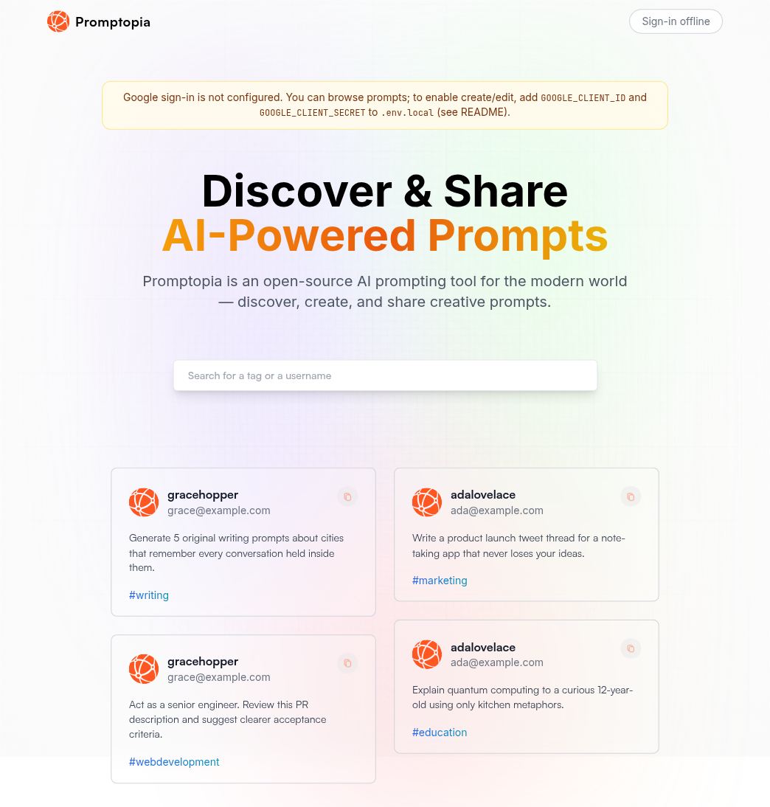
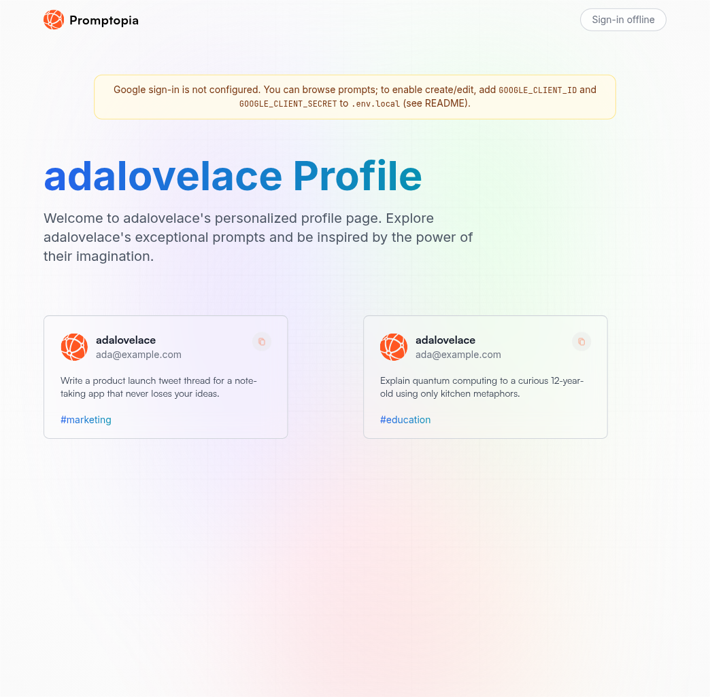
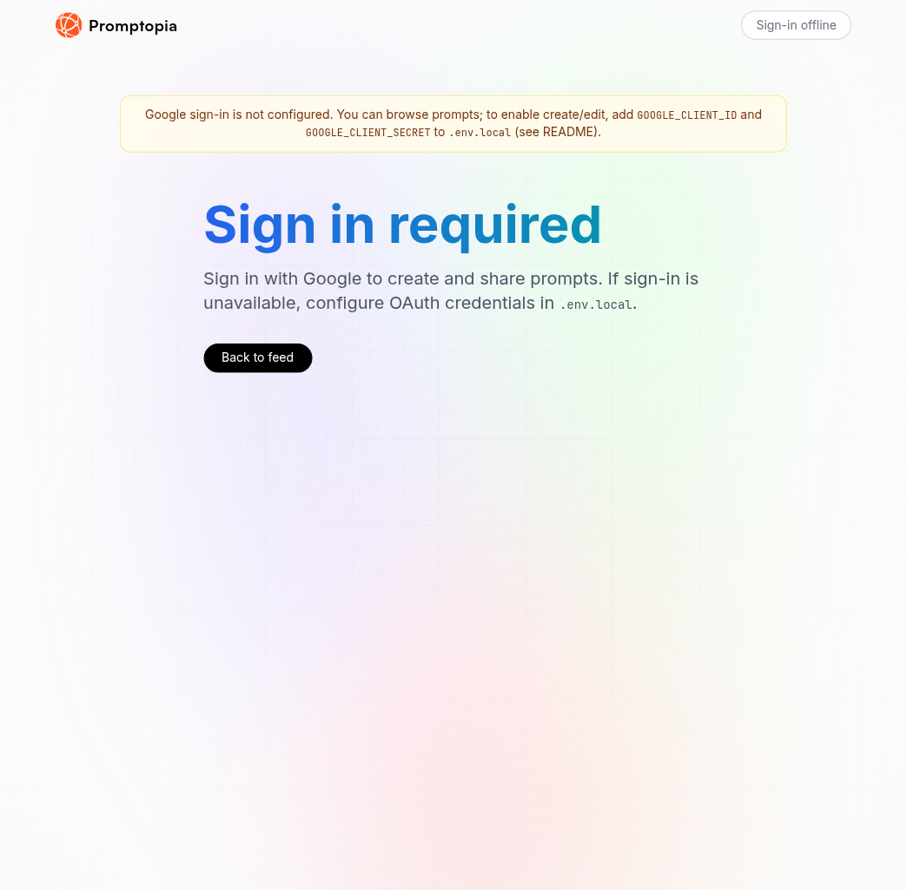
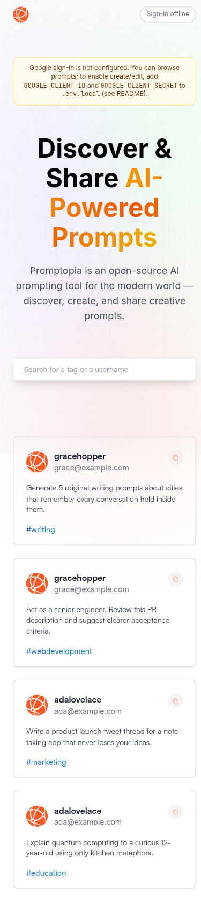

# Promptopia

An open-source AI prompt sharing app. Browse creative prompts, search by tag or author, and (with Google sign-in) create, edit, and delete your own.

Built as a polished Next.js + MongoDB portfolio project — runnable locally with Docker MongoDB, and safe to start even when OAuth env vars are missing.

## Features

- **Feed** — browse prompts with debounce search (tag, username, or prompt text)
- **Copy to clipboard** — one-click copy on any card
- **Google auth** — NextAuth sign-in (optional; app still runs without it)
- **CRUD** — create / edit / delete your prompts when signed in
- **Profiles** — your profile plus public profiles for other creators
- **Resilient UX** — loading, empty, and error states throughout

## Tech stack

- **Next.js 13** (App Router)
- **React 18** + **Tailwind CSS**
- **MongoDB** + **Mongoose**
- **NextAuth.js** (Google provider)

## Screenshots









## Quick start

### 1. Install dependencies

```bash
npm install
```

### 2. Start MongoDB

```bash
docker compose up -d
# or: npm run db:up
```

This starts MongoDB 7 on `localhost:27017` with a named volume.

### 3. Configure environment

```bash
cp .env.example .env.local
```

Minimum for browsing + seed:

| Variable          | Purpose                                          |
| ----------------- | ------------------------------------------------ |
| `MONGODB_URI`     | Mongo connection string (default matches Docker) |
| `NEXTAUTH_URL`    | App URL, e.g. `http://localhost:3000`            |
| `NEXTAUTH_SECRET` | Random secret (`openssl rand -base64 32`)        |

Optional — required only for Google sign-in / create flows:

| Variable               | Purpose                    |
| ---------------------- | -------------------------- |
| `GOOGLE_CLIENT_ID`     | Google OAuth client ID     |
| `GOOGLE_CLIENT_SECRET` | Google OAuth client secret |

If Google credentials are missing, the app still boots: you can browse the feed, and a banner explains that sign-in is offline.

### 4. Seed sample prompts (optional)

```bash
npm run seed
```

### 5. Run the app

```bash
npm run dev
```

Open [http://localhost:3000](http://localhost:3000).

## Google OAuth setup

1. Open [Google Cloud Console → Credentials](https://console.cloud.google.com/apis/credentials)
2. Create an OAuth 2.0 Client ID (Web application)
3. Add authorized redirect URI: `http://localhost:3000/api/auth/callback/google`
4. Put the client ID/secret in `.env.local` as `GOOGLE_CLIENT_ID` / `GOOGLE_CLIENT_SECRET`
5. Restart `npm run dev`

## Scripts

| Command                       | Description                 |
| ----------------------------- | --------------------------- |
| `npm run dev`                 | Development server          |
| `npm run build` / `npm start` | Production build & serve    |
| `npm run lint`                | ESLint (Next.js)            |
| `npm run format`              | Prettier write              |
| `npm run seed`                | Insert sample users/prompts |
| `npm run db:up` / `db:down`   | Docker Compose MongoDB      |

## Project structure

```
app/               # App Router pages + API routes
components/        # UI (Nav, Feed, PromptCard, Form, Profile, …)
models/            # Mongoose User & Prompt schemas
utils/database.js  # Mongo connection helper
scripts/seed.mjs   # Demo data
docker-compose.yml # Local MongoDB
```

## License

MIT
